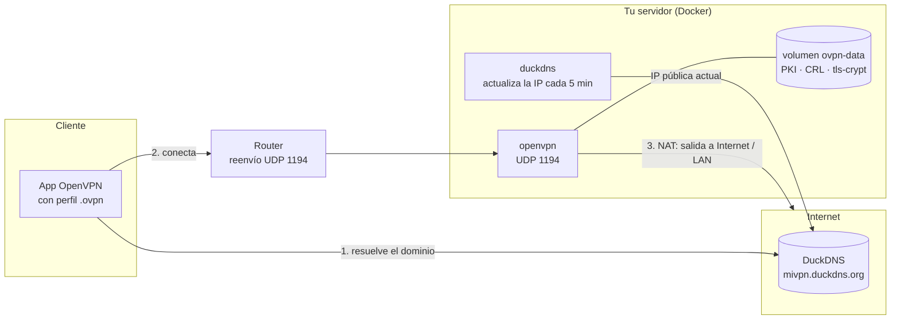

# openvpn

[](https://github.com/editech-dev/openvpn/actions/workflows/ci.yml)
[](https://github.com/editech-dev/openvpn/actions/workflows/release.yml)
[](LICENSE)

Servidor **OpenVPN** portable con **DNS dinámico (DuckDNS)**, configurable 100 % por un archivo `.env` y desplegable con **Docker Compose** en cualquier máquina Linux (PC, servidor, VPS o Raspberry Pi).

- 🔐 PKI propia generada automáticamente (CA, servidor, `tls-crypt`) con curva elíptica.
- 👥 **Lista de usuarios permitidos en una variable**: añadir un nombre emite su certificado; quitarlo lo **revoca**.
- 📦 **Script de exportación** de los perfiles `.ovpn` listos para importar en cualquier cliente.
- 🌐 DuckDNS mantiene tu dominio apuntando a tu IP pública aunque cambie.
- 🛡️ Contenedor endurecido: sistema de archivos de solo lectura, capacidades mínimas, OpenVPN corriendo como `nobody`.
- 🔁 Reconexión automática: los clientes vuelven solos tras reinicios, caídas o un cambio de IP del servidor.
- ✅ Probado en CI con un cliente OpenVPN real (conexión, revocación, persistencia, backup/restore y cambio de IP), y en producción en una VM en la nube.

---

## Índice

1. [Cómo funciona](#cómo-funciona)
2. [Requisitos](#requisitos)
3. [Inicio rápido](#inicio-rápido)
4. [Gestión de usuarios](#gestión-de-usuarios)
5. [Exportar perfiles de cliente](#exportar-perfiles-de-cliente)
6. [Variables de entorno](#variables-de-entorno)
7. [Comandos disponibles](#comandos-disponibles)
8. [Backup, restauración y migración](#backup-restauración-y-migración)
9. [Estructura del repositorio](#estructura-del-repositorio)
10. [Seguridad](#seguridad)
11. [Desarrollo y pruebas](#desarrollo-y-pruebas)
12. [Documentación adicional](#documentación-adicional)

---

## Cómo funciona



Hay **dos servicios**:

| Servicio | Imagen | Función |
|---|---|---|
| `duckdns` | `lscr.io/linuxserver/duckdns` (versión fijada) | Actualiza periódicamente tu subdominio de DuckDNS con la IP pública del host. Opcional (perfil de Compose). |
| `openvpn` | `ghcr.io/editech-dev/openvpn` (este repo, Alpine + OpenVPN 2.7 + easy-rsa 3) | Servidor VPN. Genera la PKI, sincroniza usuarios, aplica NAT y sirve el túnel. |

### Qué pasa en cada arranque del contenedor `openvpn`

1. **Carga y valida la configuración** del entorno (puertos, CIDR, nombres de usuario, DNS…). Si algo es inválido se detiene con un mensaje claro en lugar de arrancar mal.
2. **Inicializa la PKI** si no existe (solo la primera vez): CA, certificado del servidor, llave `tls-crypt` y lista de revocación (CRL). Todo se guarda en el volumen `ovpn-data`, así que **sobrevive a reinicios, actualizaciones y recreaciones** del contenedor.
3. **Sincroniza los usuarios** con `OVPN_USERS`:
   - usuario en la lista sin certificado → se le **emite** uno;
   - usuario con certificado que ya no está en la lista → se **revoca** (si `OVPN_REVOKE_REMOVED=true`);
   - usuario revocado que vuelve a la lista → **no** se reemite solo: hay que hacerlo explícitamente con `reissue` (evita reactivar a alguien por error).
4. **Regenera la CRL**, que OpenVPN consulta en cada conexión nueva.
5. **Genera `server.conf`** a partir de las variables (full o split tunnel, DNS, rutas, cifrados).
6. **Configura el NAT** (`MASQUERADE`) para que los clientes salgan a Internet/LAN a través del servidor.
7. **Arranca OpenVPN**, que baja privilegios a `nobody`. Si el kernel del host lo soporta, se usa **DCO** (Data Channel Offload) para mayor rendimiento.

### Qué pasa si el servidor se cae o cambia de IP

- Al detenerse, el servidor avisa a los clientes para que reconecten de inmediato.
- Los clientes reintentan cada 2–30 s; si la IP conocida no responde en 10 s (`server-poll-timeout`), **vuelven a resolver el dominio**, así que encuentran al servidor aunque su IP haya cambiado (DuckDNS la actualiza al arrancar y luego cada 5 minutos).
- Mientras reconectan, retiran las rutas de la VPN (`OVPN_CLIENT_PERSIST_TUN=false`): sin eso, en full tunnel la consulta DNS iría a un túnel caído y el cliente nunca se recuperaría.

### Por qué una imagen propia

La imagen popular `kylemanna/openvpn` lleva años sin mantenimiento (easy-rsa y OpenSSL antiguos). Esta imagen es pequeña, auditable (unos cientos de líneas de Bash), se reconstruye con cada parche de Alpine, se publica para `amd64`, `arm64` y `arm/v7`, y va firmada con cosign y con SBOM.

---

## Requisitos

- Linux con **Docker Engine 24+** y el plugin **Docker Compose v2**.
- Dispositivo `/dev/net/tun` disponible en el host (lo está en casi todas las distribuciones).
- Una cuenta gratuita en [duckdns.org](https://www.duckdns.org) con un subdominio y su **token** (o una IP fija / otro DNS).
- Acceso al router para **reenviar el puerto UDP 1194** (o el que configures) hacia el host.

> Si tu proveedor de Internet usa CG-NAT (no tienes IP pública real), no podrás recibir conexiones entrantes: consulta [docs/TROUBLESHOOTING.md](docs/TROUBLESHOOTING.md).

---

## Inicio rápido

```bash
# 1. Clonar
git clone https://github.com/editech-dev/openvpn.git
cd openvpn

# 2. Configurar
make init            # crea .env desde .env.example (permisos 600)
nano .env            # DUCKDNS_SUBDOMAINS, DUCKDNS_TOKEN y OVPN_USERS como mínimo

# 3. Levantar
make up
make logs            # espera "Initialization Sequence Completed"

# 4. Exportar perfiles
make export          # genera exports/<usuario>.ovpn
```

5. En el router, reenvía **UDP 1194** hacia la IP local del host.
6. Importa el `.ovpn` en la app cliente:
   - Windows/macOS/Linux: [OpenVPN Connect](https://openvpn.net/client/) u `openvpn --config usuario.ovpn`.
   - Android/iOS: OpenVPN Connect (importar archivo).
7. Prueba **desde otra red** (por ejemplo, datos móviles): conéctate y verifica que tu IP pública es la del servidor.

Guía detallada paso a paso: [docs/INSTALL.md](docs/INSTALL.md). En una VM en la nube: [docs/DEPLOY-CLOUD.md](docs/DEPLOY-CLOUD.md).

---

## Gestión de usuarios

La variable `OVPN_USERS` del `.env` es **la fuente de verdad**:

```dotenv
OVPN_USERS=ana,luis,tablet-ana
```

| Quiero… | Hago… |
|---|---|
| **Dar de alta** a alguien | Añadir su nombre a `OVPN_USERS` → `make apply` → `make export` |
| **Dar de baja** a alguien | Quitar su nombre de `OVPN_USERS` → `make apply` (se revoca su certificado) |
| **Bloquear ya** a alguien (emergencia) | `./scripts/ovpn.sh users revoke <usuario>` (revoca y lo desconecta al instante, sin reiniciar). Después quítalo del `.env`. |
| **Renovar** un certificado (vencido o perdido) | `./scripts/ovpn.sh users reissue <usuario>` → volver a exportar su perfil |
| **Reactivar** a alguien revocado | Añadirlo a `OVPN_USERS` → `./scripts/ovpn.sh users reissue <usuario>` |
| Ver el estado de todos | `make users` |
| Ver quién está conectado | `make status` |

Ejemplo de `make users`:

```
USUARIO                  ESTADO     EN_LISTA   VENCE
ana                      activo     si         Feb 24 19:24:21 2029 GMT
luis                     revocado   no         -
tablet-ana               pendiente  si         -
```

Estados: `activo` (puede conectarse), `revocado`, `vencido` (requiere `reissue`), `pendiente` (en la lista, falta `make apply`).

> **Recomendación:** un usuario por dispositivo (`ana-laptop`, `ana-movil`). Así puedes revocar un equipo perdido sin afectar a los demás.

Reglas de nombres: letras, números, `_`, `.` y `-`, hasta 64 caracteres, sin empezar por `.` ni `-`. `server` está reservado.

---

## Exportar perfiles de cliente

```bash
./scripts/export-clients.sh                    # todos los usuarios activos -> ./exports/
./scripts/export-clients.sh --user ana         # solo uno
./scripts/export-clients.sh --user ana --stdout > ana.ovpn
./scripts/export-clients.sh --zip              # además crea exports/clients-AAAAMMDD-HHMMSS.zip
./scripts/export-clients.sh --out /ruta/segura # otra carpeta
```

- Cada `.ovpn` es **autocontenido**: incluye la CA, el certificado y la llave del usuario, y la llave `tls-crypt`.
- La carpeta se crea con permisos `700` y los archivos con `600`. `exports/` está en `.gitignore`.
- Funciona con el servicio encendido o apagado (si está apagado usa un contenedor temporal).
- Solo exporta usuarios **activos** (en la lista y con certificado vigente).
- El servidor de destino (`remote`) sale de `OVPN_HOSTNAME` o, si está vacío, de `<primer subdominio>.duckdns.org`.

> ⚠️ **Un `.ovpn` equivale a una llave**: quien lo tenga puede conectarse. Envíalo por un canal seguro y bórralo de `exports/` cuando ya no lo necesites. Si se filtra, revoca a ese usuario.

---

## Variables de entorno

Todas se definen en `.env` (plantilla documentada en [`.env.example`](.env.example)). Las vacías toman el valor por defecto.

### Generales y DuckDNS

| Variable | Por defecto | Descripción |
|---|---|---|
| `COMPOSE_PROFILES` | `duckdns` | Servicios opcionales a activar. Vacío = sin DuckDNS. |
| `TZ` | `UTC` | Zona horaria (ej. `Europe/Madrid`). |
| `DUCKDNS_SUBDOMAINS` | — | Subdominio(s) sin `.duckdns.org`, separados por coma. |
| `DUCKDNS_TOKEN` | — | Token de DuckDNS (**secreto**). Ver alternativa con Docker secrets en `compose.override.example.yaml`. |
| `DUCKDNS_UPDATE_IP` | `ipv4` | `ipv4`, `ipv6` o `both`. |
| `PUID` / `PGID` | `1000` | Usuario/grupo del contenedor DuckDNS. |

### OpenVPN

| Variable | Por defecto | Descripción |
|---|---|---|
| `OVPN_USERS` | — | **Usuarios permitidos**, separados por coma. |
| `OVPN_REVOKE_REMOVED` | `true` | Revocar a quien se quite de la lista. |
| `OVPN_HOSTNAME` | `<subdominio>.duckdns.org` | Host al que se conectan los clientes. |
| `OVPN_PORT` | `1194` | Puerto público (el que reenvías en el router). |
| `OVPN_PROTO` | `udp` | `udp` (recomendado) o `tcp`. |
| `OVPN_NETWORK` | `10.8.0.0/24` | Subred interna del túnel (/16 a /29). No debe solaparse con tu LAN. |
| `OVPN_DNS` | `1.1.1.1,9.9.9.9` | DNS enviados a los clientes. |
| `OVPN_REDIRECT_GATEWAY` | `true` | `true` = full tunnel (todo el tráfico por la VPN). `false` = split tunnel. |
| `OVPN_PUSH_ROUTES` | — | Rutas a enviar a los clientes, ej. `192.168.1.0/24` para acceder a tu LAN. |
| `OVPN_CLIENT_TO_CLIENT` | `false` | Permitir tráfico entre clientes. |
| `OVPN_CLIENT_CERT_DAYS` | `825` | Vigencia de certificados de cliente. |
| `OVPN_SERVER_CERT_DAYS` | `1825` | Vigencia del certificado del servidor (solo al crear la PKI). |
| `OVPN_CA_DAYS` | `3650` | Vigencia de la CA (solo al crear la PKI). |
| `OVPN_CA_CN` | `openvpn-ca` | Nombre de la CA (solo al crear la PKI). |
| `OVPN_CIPHERS` | `AES-256-GCM:CHACHA20-POLY1305:AES-128-GCM` | Cifrados de datos negociables. |
| `OVPN_EXTRA_SERVER_CONFIG` | — | Directivas extra para `server.conf`, separadas por `\|`. |
| `OVPN_CLIENT_PERSIST_TUN` | `false` | `false`: al reconectar se retiran las rutas de la VPN para poder re-resolver el dominio (necesario con DNS dinámico). `true`: sin tráfico fuera de la VPN durante la reconexión, pero no se recupera si cambia la IP del servidor. |
| `OVPN_VERB` | `3` | Verbosidad de logs (0–11). |
| `OVPN_IMAGE_TAG` | `latest` | Versión de la imagen publicada (ej. `1.0.0`). |
| `OVPN_PULL_POLICY` | `missing` | Política de descarga de la imagen (`missing`, `always`, `never`, `build`). |

Detalle y ejemplos (split tunnel, TCP 443, acceso a LAN): [docs/CONFIG.md](docs/CONFIG.md).

> Cambiar `OVPN_HOSTNAME`, `OVPN_PORT` u `OVPN_PROTO` obliga a **volver a exportar** los perfiles. Cambiar `OVPN_CA_*` o `OVPN_SERVER_CERT_DAYS` no tiene efecto sobre una PKI ya creada.

---

## Comandos disponibles

| Make | Script equivalente | Descripción |
|---|---|---|
| `make init` | — | Crea `.env` desde la plantilla |
| `make up` / `make down` | `docker compose up -d` / `down` | Levantar / detener (la PKI se conserva) |
| `make apply` | `scripts/ovpn.sh apply` | Aplicar cambios del `.env` |
| `make users` | `scripts/ovpn.sh users list` | Estado de los usuarios |
| `make status` | `scripts/ovpn.sh status` | Clientes conectados |
| `make export` | `scripts/export-clients.sh` | Exportar perfiles |
| `make export-zip` | `scripts/export-clients.sh --zip` | Exportar y comprimir |
| `make backup` | `scripts/backup-pki.sh backup` | Backup de la PKI |
| `make logs` / `make ps` | — | Logs / estado de contenedores |
| `make config` | `scripts/ovpn.sh config` | Ver `server.conf` generado |
| `make lint` / `make test` | — | Calidad y pruebas |

Dentro del contenedor está la CLI `ovpnctl` (`docker compose exec openvpn ovpnctl --help`).

---

## Backup, restauración y migración

La PKI (volumen `ovpn-data`) es **lo único irrecuperable**: si se pierde, hay que crear una CA nueva y redistribuir todos los perfiles.

```bash
./scripts/backup-pki.sh backup                              # sin cifrar (aviso)
./scripts/backup-pki.sh backup --age-recipient age1xxxx...  # cifrado con age (recomendado)
./scripts/backup-pki.sh backup --gpg                        # cifrado simétrico con gpg
./scripts/backup-pki.sh restore backups/openvpn-pki-....tar.gz.age --yes
```

**Migrar a otro servidor:** clona el repo en el nuevo host, copia tu `.env` y el backup, ejecuta `restore` y `make up`. Los perfiles existentes siguen funcionando (si el dominio sigue siendo el mismo, DuckDNS apuntará a la nueva IP automáticamente).

Más detalles: [docs/OPERATIONS.md](docs/OPERATIONS.md).

---

## Estructura del repositorio

```
.
├── compose.yaml                  # Servicios openvpn + duckdns
├── compose.override.example.yaml # Personalización local (secrets, bind mounts)
├── .env.example                  # Plantilla de configuración documentada
├── Makefile                      # Atajos de operación
├── openvpn/                      # Imagen Docker del servidor
│   ├── Dockerfile
│   ├── entrypoint.sh             # Orquesta el arranque
│   ├── ovpnctl                   # CLI de administración (dentro del contenedor)
│   ├── healthcheck.sh
│   └── lib/
│       ├── common.sh             # Logging, validación, carga de configuración
│       ├── pki.sh                # easy-rsa: CA, servidor, clientes, CRL
│       ├── users.sh              # Sincronización OVPN_USERS ⇄ PKI
│       └── render.sh             # server.conf y perfiles .ovpn
├── scripts/                      # Herramientas para el host
│   ├── export-clients.sh
│   ├── ovpn.sh
│   └── backup-pki.sh
├── tests/
│   ├── unit/*.bats               # Pruebas unitarias
│   └── smoke.sh                  # Prueba end-to-end con cliente real
├── docs/                         # Guías detalladas
└── .github/                      # CI, release, Dependabot, plantillas
```

---

## Seguridad

- Autenticación **solo por certificado** (un certificado por usuario) + **`tls-crypt`**, que cifra y autentica el canal de control: el servidor no responde a paquetes que no estén firmados con esa llave (protege contra escaneos y DoS).
- TLS ≥ 1.2, cifrados AEAD (AES-GCM / ChaCha20-Poly1305), llaves EC P-256, sin compresión.
- Revocación mediante CRL, consultada en cada conexión; `revoke` además corta las sesiones activas.
- Contenedor con `read_only`, `no-new-privileges`, `cap_drop: ALL` y solo las capacidades necesarias; OpenVPN corre como `nobody`.
- Imágenes base fijadas por digest y actualizadas por Dependabot; escaneo con Trivy en CI; imágenes publicadas con SBOM, procedencia y firma cosign.
- Secretos fuera de git: `.env`, `exports/`, `backups/` y `secrets/` están en `.gitignore`; gitleaks revisa cada cambio.

Política de reporte de vulnerabilidades y recomendaciones de endurecimiento: [SECURITY.md](SECURITY.md).

---

## Desarrollo y pruebas

```bash
make lint        # shellcheck, hadolint, validación de compose
make test-unit   # pruebas bats
make test-smoke  # levanta servidor + cliente real: conexión, revocación, persistencia
```

Opcional: `pipx install pre-commit && pre-commit install` para ejecutar los controles (incluido gitleaks) antes de cada commit.

Convenciones: [Conventional Commits](https://www.conventionalcommits.org/es/), [SemVer](https://semver.org/lang/es/) y cambios registrados en [CHANGELOG.md](CHANGELOG.md). Una release se publica creando un tag `vX.Y.Z`.

---

## Documentación adicional

- [docs/INSTALL.md](docs/INSTALL.md): instalación paso a paso (DuckDNS, router, firewall, verificación).
- [docs/DEPLOY-CLOUD.md](docs/DEPLOY-CLOUD.md): despliegue probado en una VM en la nube (Google Cloud) y comportamiento ante caídas.
- [docs/CONFIG.md](docs/CONFIG.md): configuraciones típicas.
- [docs/OPERATIONS.md](docs/OPERATIONS.md): operación diaria, actualizaciones, backups y migración.
- [docs/TROUBLESHOOTING.md](docs/TROUBLESHOOTING.md): problemas frecuentes.
- [SECURITY.md](SECURITY.md): seguridad.

## Licencia

[MIT](LICENSE)
