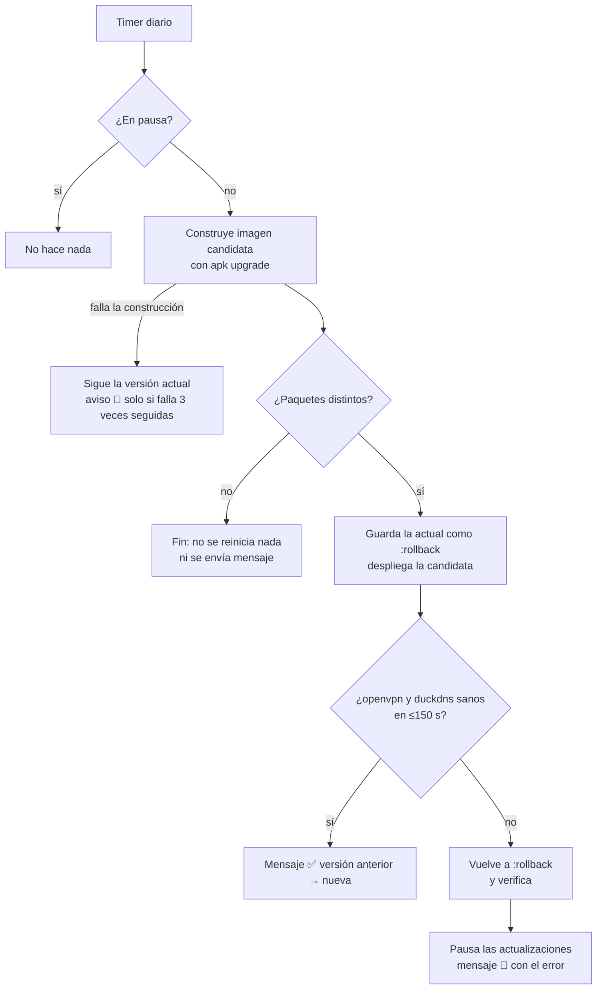

# Actualización automática, vigilancia y avisos

El servidor se mantiene al día **por sí solo, sin depender de GitHub** ni de imágenes de terceros. Si algo sale mal, vuelve a la versión anterior y te avisa por **Telegram**.

En Telegram se publican **solo dos tipos de mensaje**: una versión nueva instalada correctamente, o un error al intentar actualizar. Las revisiones sin novedades no envían nada.

| Qué | Cómo | Cuándo |
|---|---|---|
| Imagen `openvpn` + `duckdns` | Se reconstruye **en el propio servidor** con los últimos parches de Alpine. Solo se despliega si hay paquetes nuevos y luego se verifica. | A diario (configurable) |
| Sistema operativo | `unattended-upgrades` de Debian, ampliado para incluir Docker y reiniciar si un parche lo requiere (kernel, libc…). | A diario |
| Vigilancia | Comprueba que los servicios están sanos y registra cada cambio de estado en el journal (y, opcionalmente, en Telegram). | Cada 10 min y al arrancar |

Todo se instala con un único comando: `sudo ./scripts/install-host.sh`.

---

## 1. Cómo funciona la actualización



- **Sin GitHub:** la imagen se construye a partir de `openvpn/Dockerfile` con los paquetes oficiales de Alpine. Solo hace falta acceso a `dl-cdn.alpinelinux.org`, y a Docker Hub únicamente si cambia la imagen base.
- **Detección de cambios:** cada imagen guarda su lista de paquetes en `/usr/local/share/ovpn/packages.txt`. Si la candidata trae exactamente los mismos paquetes, se descarta y **no se reinicia nada**.
- **Despliegue:** se recrean ambos contenedores. Los clientes VPN reconectan solos en unos 10–15 s, y la PKI y los usuarios no se tocan.
- **Verificación:** ambos servicios deben pasar su *healthcheck* con la imagen nueva y `ovpnctl` debe responder.
- **Vuelta atrás y congelado:** si la verificación falla, se restaura la versión anterior (`…:latest-rollback`) y se crea `.state/frozen`. Mientras exista ese archivo, no se vuelve a intentar: así **se queda en la versión que funciona** hasta que lo revises.
- **Versiones mayores** (por ejemplo, Alpine 3.24 → 3.25) **no** se aplican solas: requieren cambiar el `FROM` del Dockerfile a mano y probarlo.

### Frecuencia: ¿por qué a diario?

Revisar cuesta menos de un minuto de CPU y unos pocos MB de descarga. En la nube ese tráfico es de entrada y no se suele cobrar. **Solo se reinicia algo cuando hay parches**, lo que en la práctica ocurre pocas veces al mes. Alpine publica correcciones de seguridad sin calendario fijo, así que una revisión semanal dejaría hasta 7 días de exposición.

Si prefieres otra frecuencia, cambia `AUTOUPDATE_ONCALENDAR` y vuelve a ejecutar `sudo ./scripts/install-host.sh`:

```dotenv
AUTOUPDATE_ONCALENDAR=*-*-* 04:00:00 Europe/Madrid    # diario a las 04:00 hora local
AUTOUPDATE_ONCALENDAR=Sun *-*-* 04:00:00 UTC          # semanal (domingos)
AUTOUPDATE_ONCALENDAR=*-*-01 04:00:00 UTC             # mensual
```

Comprueba una expresión con `systemd-analyze calendar "<expresión>"`.

---

## 2. Configurar los avisos de Telegram

Los avisos pueden ir a tu chat privado con el bot, a un grupo o a un **canal**.

1. En Telegram, abre **@BotFather** y envía `/newbot`. Elige un nombre y un usuario para el bot. BotFather te dará un **token** del estilo `123456789:AA…`.
2. Destino:
   - **Canal**: añade el bot como **administrador** del canal, con permiso para publicar, y publica cualquier mensaje en el canal.
   - **Chat privado**: abre el chat con el bot y envíale `/start`. Si no lo haces, el bot no puede escribirte.
3. Obtén el **chat_id** desde el servidor. El token no aparece en el historial de la shell porque se lee con `read -s`:
   ```bash
   read -rs TOKEN && curl -s "https://api.telegram.org/bot${TOKEN}/getUpdates" | grep -o '"chat":{"id":-\?[0-9]*' ; unset TOKEN
   ```
   El número que aparece tras `"id":` es el `chat_id`; en un canal empieza por `-100`. En un canal **público** también vale `@nombre_del_canal`.
4. Añade ambos valores al `.env` (que tiene permisos 600 y nunca se sube a git):
   ```dotenv
   NOTIFY_TELEGRAM_TOKEN=123456789:AA...
   NOTIFY_TELEGRAM_CHAT_ID=-1001234567890
   ```
5. Prueba: `make notify-test` (o `./scripts/notify.sh --test`). El mensaje debe llegar al canal.

Cada mensaje empieza con el nombre de la instancia (`[mivpn.duckdns.org]`) para distinguir servidores si tienes varios.

### Qué se publica

Solo dos tipos de mensaje, ambos con la **versión anterior y la nueva**:

```text
[mivpn.duckdns.org] ✅ Nueva versión instalada correctamente
Versión: OpenVPN 2.7.7-r0 · Alpine 3.24.4 → OpenVPN 2.7.8-r0 · Alpine 3.24.5
Paquetes actualizados (2):
• openssl: 3.5.9-r0 → 3.5.10-r0
• openvpn: 2.7.7-r0 → 2.7.8-r0
```

```text
[mivpn.duckdns.org] 🚨 Error al actualizar
Versión: OpenVPN 2.7.7-r0 · Alpine 3.24.4 → OpenVPN 2.7.8-r0 · Alpine 3.24.5
Error: la versión nueva no quedó sana (openvpn=unhealthy duckdns=healthy)
Detalle:
<últimas líneas de log del servicio que falló>
La VPN sigue funcionando con la versión anterior. Actualizaciones en pausa hasta revisarlo.
```

| Situación | ¿Mensaje? |
|---|---|
| Revisión sin paquetes nuevos | No |
| Versión nueva instalada y verificada | ✅ (se desactiva con `NOTIFY_ON_SUCCESS=false`) |
| La versión nueva falla y se vuelve a la anterior | 🚨 con el error |
| También falla la vuelta atrás | 🚨 con `❌ CRÍTICO: …`: hay que entrar al servidor |
| No se puede construir (sin red, repositorio caído) | Solo si ocurre `AUTOUPDATE_BUILD_FAIL_ALERT` veces seguidas (3 por defecto); un fallo puntual se reintenta al día siguiente sin avisar |
| Actualizaciones en pausa, `--unfreeze`, `--force` sin paquetes nuevos | No |
| Vigilante: servicio caído o recuperado, Docker sin respuesta, arranque del servidor | No: quedan en el journal. Con `NOTIFY_WATCHDOG=true` también se publican. |

### ¿Y si el servidor se apaga del todo?

Un servidor apagado no puede avisar. Para cubrir ese caso, crea un *check* gratuito en [healthchecks.io](https://healthchecks.io) con un periodo de 10 minutos, conéctalo a tu Telegram desde su panel y pon su URL en el `.env`:

```dotenv
NOTIFY_HEARTBEAT_URL=https://hc-ping.com/<uuid>
```

El vigilante envía un latido cada 10 minutos, a `/fail` si algún servicio no está sano. Si deja de llegar, healthchecks.io te avisa por su cuenta, sin pasar por el canal.

---

## 3. Instalar en el servidor

Requisitos: el usuario pertenece al grupo `docker`, existe el `.env` y está instalado `unattended-upgrades` (viene por defecto en Debian/Ubuntu de la nube).

```bash
cd ~/openvpn
sudo ./scripts/install-host.sh      # idempotente: vuelve a ejecutarlo tras cambiar AUTOUPDATE_*
```

Instala, con el usuario que invoca `sudo` (no como root):

| Unidad | Función |
|---|---|
| `openvpn-autoupdate.timer` / `.service` | Ejecuta `scripts/auto-update.sh` según `AUTOUPDATE_ONCALENDAR`. Tiene `Persistent=true`: si el servidor estaba apagado a esa hora, se ejecuta al arrancar. |
| `openvpn-watchdog.timer` / `.service` | Ejecuta `scripts/watchdog.sh` cada `WATCHDOG_INTERVAL`. |
| `openvpn-boot-notify.service` | Registra el arranque del servidor (y lo publica si `NOTIFY_WATCHDOG=true`). |
| `openvpn-notify-failure@.service` | Publica un error si alguna de las anteriores termina de forma inesperada (por ejemplo, por tiempo agotado). |
| `/etc/apt/apt.conf.d/52openvpn-unattended` | Incluye el repositorio de Docker en las actualizaciones del SO y activa el reinicio automático a `AUTOUPDATE_REBOOT_TIME` (hora del sistema) solo cuando un parche lo requiere. Se omite con `AUTOUPDATE_OS=false`. |

Comprobaciones:

```bash
systemctl list-timers 'openvpn-*'
sudo unattended-upgrade --dry-run -d 2>&1 | grep -i 'allowed origins'   # debe incluir Docker
journalctl -u openvpn-autoupdate -n 50                                  # historial
```

Desinstalar (no toca contenedores, PKI ni `.env`): `sudo ./scripts/install-host.sh --uninstall`.

> **Hora del reinicio:** `AUTOUPDATE_REBOOT_TIME` usa la zona del sistema, normalmente UTC en la nube. Elige una hora posterior a la de `AUTOUPDATE_ONCALENDAR` y de poco uso.

---

## 4. Operación del día a día

| Quiero… | Comando |
|---|---|
| Ver el estado (¿en pausa?, última ejecución, imágenes) | `make update-status` |
| Actualizar ahora | `make update` |
| Ver qué paquetes cambiarían, sin desplegar | `./scripts/auto-update.sh --dry-run` |
| Forzar un despliegue aunque no haya paquetes nuevos | `./scripts/auto-update.sh --force` |
| Probar la vuelta atrás y el aviso de fallo | `./scripts/auto-update.sh --simulate-failure` |
| Reanudar tras revisar un fallo | `make update-unfreeze` |
| Pausar las actualizaciones | `AUTOUPDATE_ENABLED=false` en `.env` |
| Aplicar un cambio de **código** del repo (tras `git pull`) | `make build && make up` |

### Tras un aviso de fallo 🚨

1. La VPN sigue funcionando con la versión anterior. No hay urgencia, salvo que el mensaje diga **CRÍTICO**.
2. Revisa qué pasó:
   ```bash
   make update-status
   journalctl -u openvpn-autoupdate -n 100
   docker image ls ghcr.io/editech-dev/openvpn   # la candidata fallida queda como :latest-failed
   ```
3. Prueba de nuevo, quizá ya con el parche corregido: `make update-unfreeze && ./scripts/auto-update.sh --force`.
4. Si el problema persiste, mantén la pausa hasta que salga una versión corregida de Alpine. Borra `:latest-failed` cuando ya no lo necesites: `docker rmi ghcr.io/editech-dev/openvpn:latest-failed`.

---

## 5. Variables

| Variable | Por defecto | Descripción |
|---|---|---|
| `NOTIFY_TELEGRAM_TOKEN` | — | Token del bot (**secreto**). Vacío = sin avisos; quedan solo en el journal. |
| `NOTIFY_TELEGRAM_CHAT_ID` | — | Destino: chat, grupo o canal (`-100…` o `@nombre`). |
| `NOTIFY_ON_SUCCESS` | `true` | Publicar también las actualizaciones correctas (`false` = solo errores). |
| `NOTIFY_WATCHDOG` | `false` | Publicar también los avisos del vigilante y de arranque. |
| `NOTIFY_HEARTBEAT_URL` | — | URL de latido (healthchecks.io u otro compatible), solo `https`. |
| `AUTOUPDATE_ENABLED` | `true` | `false` = el timer no hace nada. Las ejecuciones manuales con opción siguen funcionando. |
| `AUTOUPDATE_ONCALENDAR` | `*-*-* 04:00:00 UTC` | Cuándo revisar parches (formato `OnCalendar` de systemd). Se aplica un retraso aleatorio de hasta 15 min. |
| `AUTOUPDATE_VERIFY_TIMEOUT` | `150` | Segundos para que la versión nueva quede sana. |
| `AUTOUPDATE_BUILD_FAIL_ALERT` | `3` | Fallos de construcción seguidos antes de publicar un error. |
| `AUTOUPDATE_OS` | `true` | Configurar `unattended-upgrades` (Docker y reinicio automático). |
| `AUTOUPDATE_REBOOT_TIME` | `05:30` | Hora (del sistema) del reinicio automático, solo si un parche lo requiere. |
| `WATCHDOG_INTERVAL` | `10min` | Frecuencia del vigilante. |

Estas variables solo las leen los scripts del host: Compose **no** las pasa a los contenedores.

> La actualización automática trabaja con la imagen construida localmente (`OVPN_PULL_POLICY=missing`, el valor por defecto). Si usas imágenes publicadas con `OVPN_PULL_POLICY=always`, el actualizador se niega a ejecutarse para no mezclar ambos modelos.

---

## 6. Seguridad

- Los tokens de Telegram y DuckDNS se pasan a `curl` por la entrada estándar: **no aparecen en la lista de procesos ni en los logs**.
- Los timers corren con tu usuario (grupo `docker`), no como root. Solo `install-host.sh` necesita `sudo`.
- `.state/` (estado del actualizador, permisos 700) está en `.gitignore`.
- Los mensajes de error incluyen las últimas líneas de log del servicio que falló, que pueden contener nombres de usuario o IPs de clientes. Usa un canal **privado**.
