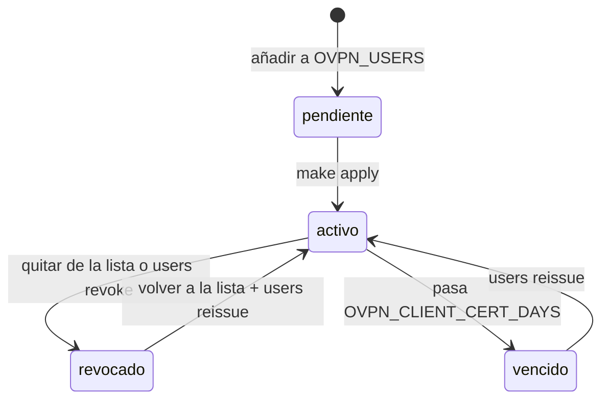

# Operación

## Ciclo de vida de un usuario



## Tareas habituales

| Tarea | Comando |
|---|---|
| Alta | editar `OVPN_USERS` → `make apply` → `make export` |
| Baja | editar `OVPN_USERS` → `make apply` |
| Baja inmediata | `./scripts/ovpn.sh users revoke <usuario>` |
| Renovar | `./scripts/ovpn.sh users reissue <usuario>` → `./scripts/export-clients.sh -u <usuario>` |
| Conectados | `make status` |
| Logs | `make logs` |

`make apply` recrea el contenedor de OpenVPN: los clientes conectados se desconectan unos segundos y se reconectan solos.

## Revisar vencimientos

`make users` muestra la fecha de vencimiento de cada certificado. Al arrancar, el servidor avisa en los logs si la CA o el certificado del servidor vencen en menos de 30 días.

- Certificados de cliente: `users reissue`.
- Certificado del servidor o la CA: hay que regenerar la PKI (ver abajo). Con los valores por defecto ocurre a los 5 y 10 años.

## Actualizar

**Parches de seguridad (automático):** con `sudo ./scripts/install-host.sh` el servidor reconstruye la imagen a diario con los parches de Alpine. Si hay paquetes nuevos, la despliega y la verifica; si falla, vuelve a la versión anterior, congela las actualizaciones y avisa por Telegram. Consulta [AUTO-UPDATE.md](AUTO-UPDATE.md). A mano: `make update`, `make update-status` y `make update-unfreeze`.

**Cambios del código del repositorio** (nuevas versiones de este proyecto):

```bash
git pull
make build      # si usas la imagen local (OVPN_IMAGE_TAG=latest)
# o, con imagen publicada: cambia OVPN_IMAGE_TAG y ejecuta: make pull
make up
```

La PKI se conserva. Lee el [CHANGELOG](../CHANGELOG.md) antes de cambiar de versión mayor.

## Backups

```bash
./scripts/backup-pki.sh backup --age-recipient "$(cat ~/.age/recipient.txt)"
```

Programa un backup periódico (ej. `crontab -e`):

```cron
0 3 * * 0  cd /opt/openvpn && ./scripts/backup-pki.sh backup --age-recipient age1... >/dev/null 2>&1
```

Guarda los backups **fuera** del servidor.

## Migrar a otro host

```bash
# servidor antiguo
./scripts/backup-pki.sh backup --gpg
scp backups/openvpn-pki-*.tar.gz.gpg .env nuevo-host:/tmp/

# servidor nuevo
git clone https://github.com/editech-dev/openvpn.git && cd openvpn
mv /tmp/.env . && chmod 600 .env
./scripts/backup-pki.sh restore /tmp/openvpn-pki-*.tar.gz.gpg --yes
make up
```

Apaga el servidor antiguo (o su `duckdns`) para que ambos no actualicen el mismo subdominio.

## Varias instancias en el mismo host

El proyecto Compose se llama `openvpn` (fijado en `compose.yaml`), y la PKI vive en el volumen `openvpn_ovpn-data` aunque renombres la carpeta. Para una segunda instancia independiente usa otro nombre: `COMPOSE_PROJECT_NAME=vpn2` en su `.env` (y otro `OVPN_PORT`).

## Empezar de cero (nueva CA)

⚠️ Invalida **todos** los perfiles existentes.

```bash
make backup            # por si acaso
docker compose down -v # borra el volumen ovpn-data
make up && make export
```
